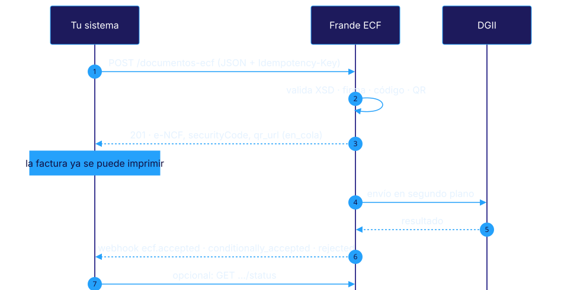
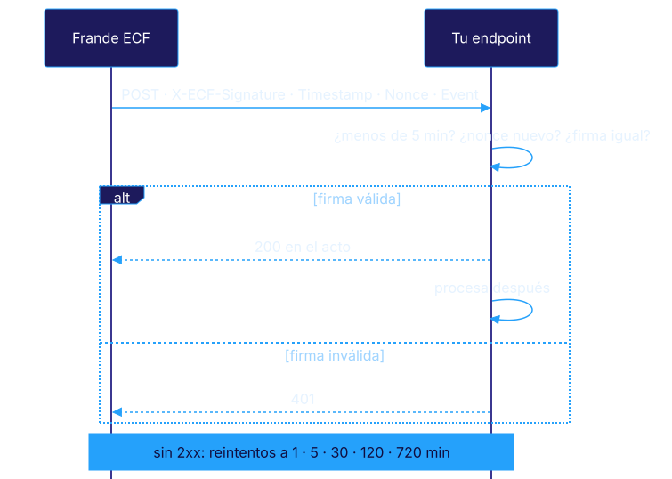

# Frande ECF · Integración

[](LICENSE)
[](openapi/frande-ecf-v1.openapi.json)
[](sdk/typescript)
[](sdk/php)

Este repositorio es la guía de integración de **Frande ECF**, la facturación electrónica (e-CF) de Frande One para la DGII de República Dominicana. Aquí aprendes a conectar tu sistema, qué enviar, qué te responde, cómo recibir cada estado y cada aviso, y qué librerías puedes agregar a tu proyecto para llamar a la API con menos código.

<p align="center"></p>

| | |
|---|---|
| API | `https://ecf.frandeone.com/v1` |
| Documentación interactiva | https://ecf.frandeone.com/api-docs |
| Contrato OpenAPI 3.0 | [`openapi/frande-ecf-v1.openapi.json`](openapi/frande-ecf-v1.openapi.json) |
| Portal (cuenta, certificado, credenciales, webhooks) | https://ecf.frandeone.com |
| Guía completa, página por página | [`guia/`](guia/README.md) |

## Contenido

1. [Cómo funciona](#1-cómo-funciona)
2. [Dos formas de integrarte](#2-dos-formas-de-integrarte)
3. [Cómo empezar](#3-cómo-empezar)
4. [Ambientes y autenticación](#4-ambientes-y-autenticación)
5. [Emitir un e-CF](#5-emitir-un-e-cf)
6. [Estados del documento](#6-estados-del-documento)
7. [Webhooks](#7-webhooks)
8. [Consultas y otras operaciones](#8-consultas-y-otras-operaciones)
9. [Errores, idempotencia y límites](#9-errores-idempotencia-y-límites)
10. [Contingencia](#10-contingencia)
11. [Tu lenguaje](#11-tu-lenguaje)
12. [SDK](#12-sdk)
13. [Pruebas](#13-pruebas)
14. [Guía completa](#14-guía-completa)
15. [Soporte](#15-soporte)

---

## 1. Cómo funciona

Tu sistema envía el comprobante en JSON. Frande ECF revisa los campos y el esquema oficial de la DGII, **firma** el XML con el certificado digital de la empresa, genera el **código de seguridad** y el **QR**, responde en el acto y se encarga del envío a la DGII, de los reintentos y de avisarte el resultado. Tu sistema nunca toca certificados, firmas ni el protocolo de la DGII.

<p align="center"></p>

**La credencial vive solo en tu backend.** Nunca la pongas en una página web, en una app móvil ni en un frontend (React, Vue, Angular, Flutter…): cualquiera podría leerla. El frontend le habla a tu backend y tu backend a Frande ECF.

## 2. Dos formas de integrarte

<p align="center"></p>

| | Empresa con su propio sistema | Integrador / desarrollador |
|---|---|---|
| Quién tiene la cuenta | La empresa | Cada cliente tiene la suya; tú tienes una cuenta de integrador |
| Certificado digital | El de la empresa | El de cada cliente (tú no lo custodias) |
| Credencial que usa tu software | La de la empresa | La que cada cliente crea en su portal; tu software guarda una por cliente |
| Documentos | Del plan de la empresa | Del pool de tu plan, con cupo por cliente |
| Cobro a tus clientes | No aplica | Lo manejas tú con tus clientes |
| Si dejas de pagar | — | **Tus clientes siguen emitiendo**: su facturación nunca se bloquea |

La API de emisión es la misma en los dos casos. Lo que cambia es la cuenta: el integrador administra a sus clientes desde la página «Desarrollador» del portal (alta de clientes, enlace de referido, cupo por cliente). La API de gestión para integradores (`/v1/developer/…`) y el portal propio `/developers` están en camino. Detalle actual en [guia/developers-y-revendedores.md](guia/developers-y-revendedores.md).

## 3. Cómo empezar

1. **Crea la cuenta** en https://ecf.frandeone.com con el RNC de la empresa.
2. **Sube el certificado digital** (`.p12`) desde el portal. Lo emite una entidad autorizada (por ejemplo DigiFirma) y se guarda cifrado; nunca viaja por la API.
3. **Crea las credenciales** en *Credenciales de API*: `foecf_test_…` para pruebas y, cuando la cuenta esté habilitada, `foecf_live_…` para producción.
4. **Prueba la conexión** con `GET /v1/TesteCF/cuenta`.
5. **Pasa los casos de prueba** (`GET /v1/TesteCF/pruebas-integracion`): 12 casos, 8 obligatorios. Con `listo_para_produccion: true`, cambia a `eCF`.

Paso a paso con ejemplos en varios lenguajes: [guia/inicio-rapido.md](guia/inicio-rapido.md) y [guia/conecta-tu-sistema.md](guia/conecta-tu-sistema.md).

## 4. Ambientes y autenticación

| Ambiente | Ruta | Para qué | Valor fiscal |
|---|---|---|---|
| `TesteCF` | `/v1/TesteCF/…` | Desarrollo y pruebas | Ninguno |
| `eCF` | `/v1/eCF/…` | Producción | Sí |

La credencial va en el encabezado **`X-API-Key`** (recomendado). También se acepta `Authorization: Bearer <clave>`, `Authorization: <clave>` o `ApiKey: <clave>`. La credencial de pruebas solo vale en `TesteCF` y la de producción solo en `eCF`.

```bash
curl -s https://ecf.frandeone.com/v1/TesteCF/cuenta -H "X-API-Key: $FRANDE_ECF_KEY"
```

Todas las respuestas tienen la misma forma. Guarda el `requestId`: es lo que soporte necesita para rastrear una petición.

```json
{ "success": true,  "data": { },  "requestId": "uuid" }
{ "success": false, "error": { "code": "ECF_VALIDATION_FAILED", "message": "…" }, "requestId": "uuid" }
```

## 5. Emitir un e-CF

`POST /v1/{env}/documentos-ecf` · un solo endpoint para los diez tipos.

<p align="center"></p>

- **El número e-NCF lo pones tú**, de las secuencias que la DGII autorizó a la empresa. Ver [guia/numeracion.md](guia/numeracion.md).
- **`Idempotency-Key`** obligatoria con credenciales `foecf_*`: un valor único por venta. Repetir con la misma clave y el mismo cuerpo devuelve la misma respuesta y no emite dos veces.
- **`referencia_externa`** (opcional): el identificador de la venta en tu sistema. Si lo reenvías, recibes el documento que ya existe.
- **`?validate=true`**: solo valida; no envía ni gasta la secuencia.

```bash
curl -s -X POST https://ecf.frandeone.com/v1/TesteCF/documentos-ecf \
  -H "X-API-Key: $FRANDE_ECF_KEY" \
  -H "Content-Type: application/json" \
  -H "Idempotency-Key: venta-000123" \
  --data @ejemplos/payloads/e31.json
```

Respuesta (`201`):

```json
{
  "success": true,
  "data": {
    "rnc": "130000001",
    "ecf": "E310000000001",
    "internalTrackId": "6f1c2b8e-…",
    "securityCode": "A1B2C3",
    "qr_url": "https://ecf.dgii.gov.do/…",
    "signedDate": "2026-04-15T14:03:22Z",
    "isRFCE": false
  },
  "requestId": "…"
}
```

**Tipos:** 31 Crédito Fiscal · 32 Consumo · 33 Nota de Débito · 34 Nota de Crédito · 41 Compras · 43 Gastos Menores · 44 Regímenes Especiales · 45 Gubernamental · 46 Exportaciones · 47 Pagos al Exterior. Las facturas de consumo (32) menores de RD$250,000 van como resumen (RFCE) y la API lo resuelve sola. El cuerpo de cada tipo, campo por campo y con ejemplo completo: [guia/emitir.md](guia/emitir.md).

## 6. Estados del documento

<p align="center"></p>

| `estado_dgii` | Qué significa | Qué haces |
|---|---|---|
| `en_cola` | Firmado y guardado; aún no sale a la DGII o espera un reintento | Nada: la factura ya es imprimible |
| `recibido` | La DGII dio un `track_id`, sin resultado final | Esperar el aviso |
| `procesando` | La DGII lo está validando | Esperar el aviso |
| `aceptado` | Aprobado. Incluye **aceptado condicional** (`dgii_code` 4, con observaciones en `dgii_message`) | Marcar la venta como aceptada |
| `rechazado` | La DGII lo rechazó; motivo en `dgii_code` y `dgii_message` | Corregir y emitir de nuevo |
| `error` | Se agotaron los reintentos sin respuesta | Revisar o escribir a soporte |

Más en [guia/estados-y-consultas.md](guia/estados-y-consultas.md).

## 7. Webhooks

En vez de consultar una y otra vez, Frande ECF te avisa con un `POST` firmado. Los destinos se configuran en el portal, uno o varios por ambiente.

<p align="center"></p>

| Evento | Cuándo |
|---|---|
| `ecf.status_update` | Cambió el estado ante la DGII |
| `ecf.accepted` · `ecf.conditionally_accepted` · `ecf.rejected` | Resultado final de la DGII |
| `ecf.received` | Te llegó un e-CF de un proveedor |
| `ecf.commercial_status` | Un comprador aprobó o rechazó comercialmente tu documento |
| `ecf.buyer_delivery` | Resultado de la entrega al comprador |
| `anecf.completed` | Terminó una anulación de secuencias |
| `certificate.expiring` | Tu certificado vence pronto (solo producción) |
| `quota.threshold` · `contingency.started` · `contingency.ended` | Próximamente |

**Firma:** `X-ECF-Signature` = `sha256=` + HMAC-SHA256 en hex de `timestamp.nonce.cuerpo` con el secreto del destino. Los dos SDK traen la verificación lista. Cuerpo de cada evento: [guia/webhooks.md](guia/webhooks.md).

## 8. Consultas y otras operaciones

| Operación | Ruta |
|---|---|
| Documento por e-NCF / por tu referencia / por ID | `GET …/documentos-ecf/por-encf/{encf}` · `…/por-referencia/{ref}` · `…/{internalTrackId}` |
| Estado en vivo ante la DGII | `GET …/documentos-ecf/{internalTrackId}/status` |
| Varios a la vez (hasta 50) | `POST …/documentos-ecf/batch-status` |
| PDF (representación impresa) y XML firmado | `GET …/{internalTrackId}/pdf` · `…/xml` |
| Anular secuencias no usadas (ANECF) | `POST …/anulacion-ecf` |
| Recibidos, su XML y su acuse (ARECF) | `GET …/documentos-recibidos` · `…/{id}/xml` · `…/{id}/arecf` |
| Aprobación o rechazo comercial (ACECF) | `POST …/documentos-recibidos/{id}/approve` · `…/reject` |
| Directorio DGII de un comprador | `GET …/directorio/{rnc}` |
| Certificado activo y prueba de autenticación con la DGII | `GET …/certificates/info` · `POST …/certificates/test-auth` |

Notas de crédito y débito, anulaciones y recibidos: [guia/corregir-y-anular.md](guia/corregir-y-anular.md) y [guia/recibidos.md](guia/recibidos.md).

## 9. Errores, idempotencia y límites

- Cada error trae un `code` estable. Catálogo completo, con la causa y qué hacer: [guia/errores.md](guia/errores.md).
- Las respuestas `5xx`, `408` y `429` no quedan guardadas por la idempotencia: reintenta con la **misma** `Idempotency-Key`. Ver [guia/idempotencia.md](guia/idempotencia.md).
- Límite de emisión: 30 por minuto por cuenta y 5 MB por cuerpo. Al pasarte, `429` con `Retry-After`. Ver [guia/limites-y-planes.md](guia/limites-y-planes.md).

## 10. Contingencia

Según el *Instructivo de Contingencia de Facturación Electrónica* de la DGII y el Decreto 587-24 (arts. 39 a 43):

| Qué falla | Qué pasa | Qué hace la empresa |
|---|---|---|
| **La DGII** no responde o está en mantenimiento | Frande ECF ya firmó el e-CF (código y QR válidos), lo guarda y lo envía cuando la DGII vuelve | Nada. Imprime normal |
| **La conexión** entre tu sistema y Frande ECF | Tu sistema no recibe la firma | Reintenta con la misma `Idempotency-Key` |
| **No se puede emitir e-CF** (corte prolongado) | Contingencia formal | Declarar la entrada en la Oficina Virtual (Facturación Electrónica → Contingencia FE), emitir serie B autorizada (máximo 15 días), declarar la salida y, en 30 días, enviar los e-CF de reemplazo (código 4, solo a la DGII) |

Detalle: [guia/contingencia.md](guia/contingencia.md) y [docs/contingencia-dgii.md](docs/contingencia-dgii.md).

## 11. Tu lenguaje

La API es HTTP y JSON: funciona desde cualquier lenguaje.

| Lenguaje | Cómo |
|---|---|
| TypeScript / JavaScript (Node 18+) | SDK [`@frandeone/ecf`](sdk/typescript) |
| PHP 8.1+ | SDK [`frandeone/ecf-sdk`](sdk/php) |
| Python, C# / .NET | Ejemplos en cada página de la [guía](guia/README.md) |
| Java, Kotlin, Swift, Go, C++, Delphi, Ruby… | Genera un cliente desde el contrato OpenAPI (abajo) o usa los ejemplos con `curl` |
| React, Vue, Angular, Flutter, apps móviles | **Nunca llames a la API desde ahí.** Llama a tu backend y que él use el SDK |

Generar un cliente con [OpenAPI Generator](https://openapi-generator.tech):

```bash
# Java, Kotlin, Swift, C#, Go, Python… cambia el -g por tu lenguaje
npx @openapitools/openapi-generator-cli generate \
  -i https://ecf.frandeone.com/openapi.json -g java -o cliente-frande-ecf
```

## 12. SDK

Opcionales: llaman a la misma API, con la autenticación, la idempotencia, los errores con su código y la verificación de webhooks ya resueltos.

```bash
npm install @frandeone/ecf
composer require frandeone/ecf-sdk
```

```ts
import { FrandeEcf, FrandeEcfError } from '@frandeone/ecf';
const ecf = new FrandeEcf({ apiKey: process.env.FRANDE_ECF_KEY!, ambiente: 'TesteCF' });
const r = await ecf.emitir(payload, { idempotencyKey: `venta-${venta.id}` });
```

```php
$ecf = new Frande\Ecf\Client(getenv('FRANDE_ECF_KEY'), 'TesteCF');
$r = $ecf->emitir($payload, 'venta-' . $venta['id']);
```

Guía de cada uno: [sdk/typescript](sdk/typescript) · [sdk/php](sdk/php).

## 13. Pruebas

- **Colección Bruno** en [`bruno/`](bruno): todas las operaciones listas para probar contra `TesteCF`. Abre la carpeta en [Bruno](https://www.usebruno.com), elige el ambiente `TesteCF` y pon tu credencial `foecf_test_…` (se guarda como secreto, no en el archivo).
- **Casos de prueba de integración** del sandbox: 12 casos que Frande ECF detecta solo mientras pruebas. Ver [guia/casos-de-prueba.md](guia/casos-de-prueba.md).
- **Pruebas de los SDK:** `npm test` en `sdk/typescript` y `php sdk/php/tests/run.php`. Corren solas en cada cambio (GitHub Actions).

## 14. Guía completa

| Tema | Página |
|---|---|
| Inicio rápido | [inicio-rapido](guia/inicio-rapido.md) |
| Conecta tu sistema | [conecta-tu-sistema](guia/conecta-tu-sistema.md) |
| Ambientes y credenciales | [ambientes-y-credenciales](guia/ambientes-y-credenciales.md) |
| Emitir un e-CF (los 10 tipos) | [emitir](guia/emitir.md) |
| Casos de prueba del sandbox | [casos-de-prueba](guia/casos-de-prueba.md) |
| Numeración | [numeracion](guia/numeracion.md) |
| Idempotencia y reintentos | [idempotencia](guia/idempotencia.md) |
| Estados, consultas y archivos | [estados-y-consultas](guia/estados-y-consultas.md) |
| Corregir y anular | [corregir-y-anular](guia/corregir-y-anular.md) |
| Recibidos y aprobación comercial | [recibidos](guia/recibidos.md) |
| Contingencia | [contingencia](guia/contingencia.md) |
| Webhooks y verificación de firma | [webhooks](guia/webhooks.md) |
| Catálogo de errores | [errores](guia/errores.md) |
| Límites y planes | [limites-y-planes](guia/limites-y-planes.md) |
| Developers y revendedores | [developers-y-revendedores](guia/developers-y-revendedores.md) |
| Referencia y registro de cambios | [referencia](guia/referencia.md) |
| Texto para asistentes de IA | [llms.txt](guia/llms.txt) |

## 15. Soporte

- **Dudas o fallos de integración:** abre un [issue](https://github.com/franklindemanchedelizon/Integracion_Frande-ECF/issues/new/choose) (nunca pegues tu credencial ni datos de clientes).
- **Problemas de seguridad:** escribe a soporte@frandeone.com, no en un issue público. Ver [SECURITY.md](SECURITY.md).
- **Soporte directo:** soporte@frandeone.com · 809-765-3566 (teléfono y WhatsApp) · https://ecf.frandeone.com
- Incluye siempre el `requestId` de la respuesta.

---

<p align="center">Frande One · Frande Connection SRL · San Pedro de Macorís, República Dominicana · <a href="https://www.frandeone.com">www.frandeone.com</a></p>
